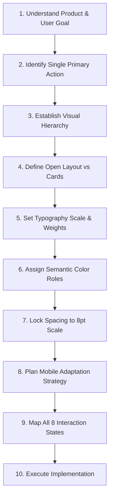

# Apple Premium UI: Human Interface Philosophy for the Web

This skill enforces the timeless product design discipline of Apple's Human Interface Guidelines (HIG) translated into modern, production-grade web applications. Its mission is to eliminate generic "AI-slop" styling (glowing gradients, endless rounded cards, arbitrary glassmorphism, floating decoration) and replace it with calm, confident, content-first software that feels meticulously engineered.

---

## The Core Cardinal Rule

For every interface, layout, and component, enforce this strict priority order:

```
CONTENT  >  STRUCTURE  >  TYPOGRAPHY  >  SPACING  >  COLOR  >  DECORATION
```

**Never reverse this order.** If the layout does not work in pure black-and-white typography and spacing, no gradient, shadow, card border, or motion will rescue it.

> [!IMPORTANT]
> **HIG Philosophy ≠ Copying Apple's Proprietary Assets**
> Do not blindly replicate Apple product UI, SF Symbols, proprietary icons, copyright branding, or hardware mockups. Apply Apple's underlying design principles—clarity, spatial rhythm, intentional hierarchy, restrained materials, and physical feedback—to standard web technologies.

---

## When to Activate This Skill

Activate this skill automatically whenever the user asks to:
- Build a UI, landing page, dashboard, or SaaS application
- Redesign or polish an existing web or mobile web interface
- Improve UX, readability, or visual hierarchy
- Make an interface look "premium", "modern", "clean", or "Apple-like"
- Remove "AI-slop", template noise, or visual clutter
- Create responsive layouts that feel native and tactile

---

## 1. Anti-AI-Slop Rules

Generic AI-generated interfaces look instantly identifiable because they rely on decorative crutches instead of structural design. **You must strictly avoid the following anti-patterns:**

### ❌ Strict Prohibitions (Never Automatically Generate)

| Anti-Pattern | Why It Breaks Premium Feel | What to Do Instead |
| :--- | :--- | :--- |
| **Endless Card Grids** | Encapsulating every statistic, paragraph, and form in its own rounded box creates claustrophobic visual noise. | Use **open layouts**, generous negative space, subtle typography contrast, and hairline dividers. |
| **Purple/Cyan Neon Gradients & Blobs** | The universal signature of generic AI templates and crypto landing pages. | Use a **restrained neutral palette** with one semantic accent color used strictly for primary intent. |
| **Excessive Glassmorphism** | Frosted glass backgrounds on every surface muddy contrast, harm legibility, and degrade performance. | Reserve translucent blur **strictly for sticky headers, navigation sheets, or floating toolbars**. |
| **Floating Decorative Shapes** | Random blur circles, 3D spheres, and floating badges serve zero user purpose. | **Remove all non-functional decorative objects.** Let product data and typography carry the visual weight. |
| **Arbitrary & Extreme Corner Radii** | Slapping `rounded-3xl` or `rounded-full` onto containers creates childish, bloated geometry. | Use **controlled radii** matching element hierarchy: 6px–8px for inputs/buttons, 12px–16px for surface panels. |
| **Heavy / Glowing Drop Shadows** | Deep, dark, or colored drop shadows feel dated, heavy, and artificial. | Use **multi-layered, ultra-subtle ambient shadows** with 3%–6% opacity, or rely on a 1px hairline border. |
| **Pill Badges Everywhere** | Tagging every heading with a pill badge ("✨ AI-Powered Magic") cheapens the interface. | Write confident, concise headings that communicate value directly without badge crutches. |
| **Emoji as UI Iconography** | Using emojis (🚀, 🔥, 💡) as interface icons degrades professional trust. | Use clean, consistent, monoline SVG icons (Lucide, Radix Icons, or Heroicons) sized uniformly to 16px–20px. |
| **Arbitrary Spacing Values** | Mixing 14px, 19px, 23px, 37px spacing creates visual dissonance. | Lock to a **strict 4px / 8px scale** (4, 8, 12, 16, 24, 32, 48, 64, 80, 96px). |
| **Gratuitous Animations** | Bouncing buttons, constantly pulsing gradients, and spinning icons distract and annoy. | Employ **purposeful, spring-based motion** that only responds to user interaction or communicates state change. |

---

## 2. Core Design Philosophy

1. **Hierarchy**: The most important element on the screen must be immediately obvious within 50 milliseconds of scanning.
2. **Simplicity**: Remove every line, border, background, and icon that does not directly clarify meaning.
3. **Clarity**: Text must be effortless to read. Labels must be unambiguous. Interactive affordances must be obvious.
4. **Consistency**: A button is always the same height, with the same radius, padding, and hover physics throughout the app.
5. **Spatial Rhythm**: Whitespace is not empty space—it is an active structural tool that groups related items and breathes confidence.
6. **Typography**: Type scale, weight, and tracking do 80% of the visual heavy lifting before color is introduced.
7. **Content-First**: Chrome, borders, and controls recede into the background. User content takes center stage.
8. **Subtle Depth**: Surfaces feel like physical materials layered in space, separated by light and hairline borders rather than heavy dropshadows.
9. **Natural Interaction**: Controls respond with crisp, tactile physical feedback to touch, click, hover, and focus.
10. **Accessibility**: Every color meets WCAG AA/AAA contrast. Every control has a visible keyboard focus state.
11. **Responsive Behavior**: Mobile is not desktop squished down; it is an intentional touch-first reimagining of the same content.
12. **Purposeful Motion**: Motion is informative and snappy, never ornamental. It respects `prefers-reduced-motion`.

---

## 3. Typography: The Backbone of the System

Premium Apple-style interfaces convey hierarchy through **scale, weight, and letter-spacing (tracking)**, not by splashing arbitrary colors or borders across the screen.

### The System-First Web Font Stack

Never force the user to download heavy proprietary Apple font files from unofficial CDNs. Rely on modern high-quality system and neutral sans fonts:

```css
font-family:
  Inter,
  -apple-system,
  BlinkMacSystemFont,
  "SF Pro Display",
  "SF Pro Text",
  "Segoe UI",
  Roboto,
  Helvetica,
  Arial,
  sans-serif;
```

### Typographic Hierarchy & Tracking Rules

| Role | Size | Line Height | Weight | Letter Spacing (Tracking) | Usage |
| :--- | :--- | :--- | :--- | :--- | :--- |
| **Display / Hero** | `40px`–`56px` | `1.1`–`1.15` | `600` or `700` | `-0.025em` to `-0.035em` (Tight) | Main hero statements. Short line lengths (max 20–30 characters). |
| **Title 1 / Page Header** | `28px`–`34px` | `1.2` | `600` | `-0.02em` | Primary page views, section milestones. |
| **Title 2 / Section** | `22px`–`24px` | `1.25` | `600` | `-0.015em` | Grouped section titles, major modal headers. |
| **Headline / Subhead** | `17px`–`18px` | `1.35` | `500` or `600` | `-0.01em` | Card headlines, list titles, table headers. |
| **Body (Default)** | `15px`–`16px` | `1.5` | `400` (Regular) | `-0.005em` | Paragraphs, descriptions, general data. Max line width: 65ch. |
| **Callout / Secondary** | `13px`–`14px` | `1.4` | `400` or `500` | `0em` | Form labels, secondary hints, table cells. |
| **Footnote / Caption** | `11px`–`12px` | `1.35` | `400` or `500` | `+0.01em` (Slightly Open) | Timestamps, badge text, metadata, legal copy. |

### Typography Rules of Thumb
- **Restrict Font Weights**: Limit the entire page to 3 weights maximum: Regular (`400`), Medium (`500`), and Semi-bold (`600`). Avoid mixing 300, 700, 800, and 900 across the same screen.
- **Tighten Large Headers**: As font size increases, letter-spacing must become tighter (`-0.02em` to `-0.03em`) to prevent letters from feeling loose.
- **Open Small Metadata**: At 11px–12px, loosen letter-spacing (`+0.01em`) to maintain legibility.
- **Controlled Measure**: Never let body text stretch across a 1200px container. Cap reading paragraphs at `60ch` to `68ch`.

---

## 4. Layout & The Spacing Grid

A calm interface requires mathematical spatial consistency. Eliminate arbitrary margins (`margin: 17px; padding: 29px;`).

### The Strict 8pt Scale

```
4px   (0.25rem)  — Micro gaps, tight icon-to-label offsets
8px   (0.5rem)   — Inner element padding, compact spacing
12px  (0.75rem)  — Form input internal padding, tight list gap
16px  (1.0rem)   — Standard component padding, standard gap
24px  (1.5rem)   — Section internal padding, card body padding
32px  (2.0rem)   — Component group separation
48px  (3.0rem)   — Section-to-section rhythm
64px  (4.0rem)   — Page block separation, major section breaks
80px  (5.0rem)   — Hero spacing, desktop landing divisions
96px+ (6.0rem+)  — Large showcase editorial whitespace
```

### Desktop Layout Rules
- **Centered Max-Width**: Keep main application content within `1200px` to `1280px` max container width with responsive side gutters (`px-6` or `px-8`).
- **Clear Columns**: Use standard 12-column grids or simple CSS grid templates with consistent gutters (`gap-6` or `gap-8`).
- **Asymmetric Balance**: Don't force everything into symmetric 3x3 grids. Group related items logically so secondary elements support the primary anchor.

### Mobile Layout Rules
- **Never Shrink Desktop**: Do not scale fonts down to unreadable sizes or squeeze 3 columns into 3 tiny squished blocks.
- **Touch-First Stacking**: Stack layouts vertically with clear visual separation.
- **Safe Touch Targets**: All interactive elements (buttons, inputs, menu triggers) must meet a minimum bounding box of **44px × 44px**.
- **Edge-to-Edge Margins**: Maintain clean horizontal padding (`px-4` or `px-5`) so content never touches screen bezels.

---

## 5. Cards & Surface Grouping: When NOT to Use Cards

> [!WARNING]
> **Cards are NOT the default container.**
> A common AI failure is turning every headline, form, paragraph, and statistic into an isolated boxed card. When a page has 18 cards, nothing has priority and the page looks like a disordered grid of bricks.

### Use Open Layouts First
Before creating a card, ask:
1. *Can this information be separated simply using generous whitespace (`gap-8` / `gap-12`)?*
2. *Can a simple 1px hairline divider (`border-t border-neutral-200/80 dark:border-neutral-800/80`) create sufficient separation?*
3. *Does grouping with an understated section title solve the hierarchy without enclosing boxes?*

### When Cards Are Justified
Use cards only when:
- Content items are **independently actionable or selectable** (e.g., pricing plan choices, draggable workspace boards, distinct interactive entities).
- Grouping disparate interactive inputs into a coherent unit (e.g., a checkout billing module).

### The Anatomy of an Apple-Inspired Card
When a card is necessary, style it with restraint:
- **Hairline Border**: `1px solid rgba(0, 0, 0, 0.08)` in light mode, `1px solid rgba(255, 255, 255, 0.1)` in dark mode.
- **Subtle Surface**: Pure flat background or faint translucent tint (`bg-white` or `bg-neutral-50/50`).
- **Restrained Corner Radius**: `rounded-xl` (`12px`) or `rounded-2xl` (`16px`). Never use extreme `rounded-[40px]`.
- **Soft Ambient Shadow**: Minimal elevation:
  ```css
  /* Subtle, natural elevation */
  box-shadow: 
    0 1px 2px 0 rgba(0, 0, 0, 0.04),
    0 4px 12px 0 rgba(0, 0, 0, 0.03);
  ```

---

## 6. Color System: Restraint & Semantic Purpose

Apple's aesthetic uses color as a **precision tool for feedback and focus**, never as decorative background noise.

### Foundational Palette Definition

```css
:root {
  /* Light Mode */
  --bg-canvas: #FFFFFF;
  --bg-surface: #F5F5F7;          /* Apple's classic muted neutral gray */
  --bg-surface-elevated: #FFFFFF;
  
  --fg-primary: #1D1D1F;          /* High contrast, not harsh pure #000 */
  --fg-secondary: #86868B;        /* Muted labels, secondary metadata */
  --fg-tertiary: #A1A1A6;         /* Placeholder text, disabled markers */
  
  --border-subtle: rgba(0, 0, 0, 0.08);
  --border-divider: rgba(0, 0, 0, 0.06);
  --border-hover: rgba(0, 0, 0, 0.16);

  --accent-primary: #0071E3;      /* Crisp, accessible system blue */
  --accent-hover: #0077ED;
  --accent-destructive: #FF3B30;  /* System red */
  --accent-success: #34C759;      /* System green */
  --accent-warning: #FF9500;      /* System amber */
}

.dark {
  /* Dark Mode */
  --bg-canvas: #000000;
  --bg-surface: #161617;          /* Deep charcoal/zinc, not saturated purple */
  --bg-surface-elevated: #1D1D1F;
  
  --fg-primary: #F5F5F7;
  --fg-secondary: #86868B;
  --fg-tertiary: #6E6E73;
  
  --border-subtle: rgba(255, 255, 255, 0.12);
  --border-divider: rgba(255, 255, 255, 0.08);
  --border-hover: rgba(255, 255, 255, 0.24);

  --accent-primary: #2997FF;      /* High-contrast accessible blue on dark */
  --accent-hover: #40A4FF;
  --accent-destructive: #FF453A;
  --accent-success: #30D158;
  --accent-warning: #FF9F0A;
}
```

### Color Rules
- **No Random Multi-Colored Gradients**: Do not blend purple, pink, orange, and blue into card backgrounds or headings.
- **One Primary Intent Color**: Choose one semantic accent (typically deep neutral black, or system blue `#0071E3`) for primary calls to action.
- **High Text Contrast**: All body text against backgrounds must easily satisfy the **WCAG 4.5:1 ratio** (and 3:1 for large headers).

---

## 7. Materials, Translucency & Depth

Depth in Apple interfaces is achieved through **layering and light**, not artificial heavy drop shadows or overwhelming glassy blur.

### Principles of Translucency
- **Purpose-Driven Only**: Translucency should only be used where the content scrolls beneath a fixed surface (such as a sticky navigation bar or modal backdrop) so the user senses spatial continuity.
- **Specification for Sticky Headers / Navigation**:
  ```css
  background-color: rgba(255, 255, 255, 0.8);
  backdrop-filter: blur(20px) saturate(180%);
  -webkit-backdrop-filter: blur(20px) saturate(180%);
  border-bottom: 1px solid var(--border-divider);
  ```
- In dark mode:
  ```css
  background-color: rgba(22, 22, 23, 0.8);
  backdrop-filter: blur(20px) saturate(180%);
  -webkit-backdrop-filter: blur(20px) saturate(180%);
  border-bottom: 1px solid var(--border-divider);
  ```

---

## 8. Buttons & Interactive Controls

Buttons must look tactile, confident, and distinct in hierarchy.

### Button Hierarchy

```
Primary:    Solid high-contrast surface (Dark on light mode, light on dark mode, or System Blue)
Secondary:  Muted surface with subtle background (#E8E8ED or rgba(0,0,0,0.05))
Tertiary:   Transparent surface, crisp label, visible on hover/focus (Ghost button)
Text Link:  Clean text with chevron icon (e.g. "Learn more >")
```

### Button Specifications
- **Height & Padding**:
  - Regular button: Height `36px` to `40px`, horizontal padding `16px` to `20px`.
  - Large call-to-action: Height `44px` to `48px`, horizontal padding `24px` to `28px`.
- **Corner Radius**: Controlled rounded (`rounded-lg` or `rounded-xl`, e.g. `8px` to `12px`). Avoid full pill capsules unless specifically modeling an inline tag or filter chip.
- **Physical Feedback (CSS Micro-Interaction)**:
  ```css
  .btn-apple-primary {
    display: inline-flex;
    align-items: center;
    justify-content: center;
    font-size: 14px;
    font-weight: 500;
    letter-spacing: -0.01em;
    padding: 0 18px;
    height: 38px;
    border-radius: 980px; /* or 10px depending on style */
    background-color: var(--fg-primary);
    color: var(--bg-canvas);
    transition: transform 0.15s cubic-bezier(0.2, 0, 0, 1), opacity 0.15s ease;
    border: none;
    cursor: pointer;
  }

  .btn-apple-primary:hover {
    opacity: 0.92;
  }

  .btn-apple-primary:active {
    transform: scale(0.97);
    opacity: 0.85;
  }

  .btn-apple-primary:focus-visible {
    outline: 2px solid var(--accent-primary);
    outline-offset: 2px;
  }
  ```

### What to Avoid in Buttons
- ❌ Gradient fills (e.g., linear-gradient from purple to pink).
- ❌ Glowing neon drop shadows around buttons (`box-shadow: 0 0 20px #8b5cf6`).
- ❌ Random decorative icons (like stars, sparkles, rockets) unless they have explicit functional utility.

---

## 9. Navigation & Spatial Architecture

### Desktop Navigation
- **Clean, Low-Profile Navigation Bar**: Height between `48px` and `56px`.
- **Restrained Active Indicator**: Do not use glaring neon bars. Use subtle font-weight shifts (`font-medium`) or a faint pill highlight (`bg-black/5 dark:bg-white/10`).
- **Predictable Layout**: Logo on far left, navigation links centered or left-aligned, secondary actions and primary CTA on far right.

### Mobile Navigation
- **Prioritize Top 3–4 Actions**: Don't cram 8 tabs into a bottom bar.
- **Bottom Sheets for Complex Menus**: When displaying filtered settings or drill-downs on touch screens, slide up a native-feeling sheet with drag handle rather than opening a cluttered dropdown.
- **Sticky Actions**: On mobile checkout or conversion forms, pin the primary action button to the bottom viewport with a blurred background.

---

## 10. Motion, Physics & Spring Curves

Animations in an Apple-inspired interface are never there to show off. They exist to **maintain spatial orientation and give physical weight to state transitions**.

### Duration & Timing Rules
- **Micro-Interactions (Hovers, Toggles, Button presses)**: `120ms`–`180ms`. Snappy and immediate.
- **Dropdowns, Sheets, Dialogs**: `200ms`–`280ms`.
- **Page Transitions & Large Panels**: `300ms`–`400ms`.
- **Curve**: Never use standard sluggish CSS `ease` or linear motion. Use snappy spring-like cubic beziers:
  ```css
  /* Physical, snappy deceleration */
  transition-timing-function: cubic-bezier(0.16, 1, 0.3, 1);
  ```

### Reduced Motion Requirement
Always honor user accessibility preferences:
```css
@media (prefers-reduced-motion: reduce) {
  *, *::before, *::after {
    animation-duration: 0.01ms !important;
    animation-iteration-count: 1 !important;
    transition-duration: 0.01ms !important;
    scroll-behavior: auto !important;
  }
}
```

---

## 11. Complete Interaction States (The 8-State Rule)

Never design or code an interactive component for only the "happy default path". Every interactive element must gracefully support all 8 states:

1. **Default**: Crisp, clear affordance, high legibility.
2. **Hover**: Understated visual reaction (slight brightness shift, faint background tint, cursor pointer).
3. **Focus**: Distinct, high-contrast outline visible for keyboard navigation (`focus-visible:ring-2 focus-visible:ring-offset-2`).
4. **Active (Pressed)**: Subtle tactile compression (`transform: scale(0.98)`).
5. **Loading**: Clear, unobtrusive spinner or progress indicator; preserve the exact button width to avoid layout shift.
6. **Disabled**: Reduced opacity (`opacity-50`), `cursor-not-allowed`, removed pointer events.
7. **Error**: Clear inline error message in semantic red with an explanatory label below the input, not just an unexplained red border.
8. **Success / Complete**: Subtle visual confirmation (e.g. checkmark transition).

---

## 12. Accessibility (a11y) Discipline

A truly premium interface is accessible to all users without compromise:
- **Semantic HTML First**: Use `<main>`, `<nav>`, `<header>`, `<footer>`, `<section>`, `<article>`, `<button>`, `<dialog>` rather than nested `<div>` soup.
- **Color Contrast**: Verify all body text and UI controls against WCAG 2.1 AA (minimum 4.5:1 for body, 3:1 for large text).
- **Visible Focus Rings**: Never do `outline: none;` without providing a custom `:focus-visible` ring.
- **Touch Targets**: Minimum 44px × 44px for every touchable target on mobile.
- **Accessible Forms**: Every `<input>` must have a linked `<label for="...">` or `aria-label`. Error messages must use `aria-describedby` or `aria-live`.

---

## 13. Responsive Breakpoint Matrix

Test and tailor interfaces across these critical viewport thresholds:

| Breakpoint | Target Device Class | Layout Adaptation Strategy |
| :--- | :--- | :--- |
| **320px–375px** | Compact Mobile (SE, Mini) | Single column, compact 14px typography, 16px gutters, stacked buttons. |
| **390px–430px** | Modern Standard Smartphones | Full touch targets, sticky bottom navigation or CTA bar, edge-to-edge content. |
| **768px–1024px** | Tablets / Small Laptops | 2-column dashboards, collapsible sidebars, relaxed whitespace. |
| **1280px–1440px+** | Desktop Displays | Full 12-column grid, max-w-7xl centered container, rich spatial rhythm. |

---

## 14. 10-Step Design Review Workflow (Before Writing Code)

Before typing any JSX, HTML, or CSS for a major view or component, execute this 10-step mental blueprint:



1. **Understand Product & User Goal**: What is the primary problem this screen solves for the user?
2. **Identify Primary Action**: What is the single most critical button or decision on this view?
3. **Establish Visual Hierarchy**: Rank the elements (Level 1, Level 2, Level 3). Make sure Level 1 is impossible to miss.
4. **Define Open Layout vs Cards**: Can we present this with open whitespace and dividers instead of boxes?
5. **Set Typography Scale & Weights**: Select font sizes, line heights, and negative tracking for headers.
6. **Assign Semantic Color Roles**: Choose background, primary text, muted metadata, and single accent color.
7. **Lock Spacing to 8pt Scale**: Assign precise spacing tokens (16px, 24px, 32px, 64px).
8. **Plan Mobile Adaptation Strategy**: How does this reorganize at 390px?
9. **Map All 8 Interaction States**: Specify default, hover, active, focus, disabled, and loading appearances.
10. **Execute Implementation**: Write clean, production-ready, semantic code.

---

## 15. Post-Implementation UI Quality Audit

Immediately after writing or updating an interface, run this self-audit. If any answer is **NO**, revise the code before delivering it:

- [ ] **Is the hierarchy obvious?** Does the viewer's eye land instantly on the most critical element?
- [ ] **Did I remove all AI slop?** Are there zero random gradient blobs, neon buttons, excessive glassmorphism, or decorative emojis?
- [ ] **Is the card count minimized?** Did I use open layouts and whitespace rather than nesting everything in cards?
- [ ] **Is spacing disciplined?** Does every margin and padding adhere strictly to the 4px/8px scale?
- [ ] **Are sections visually balanced?** Is negative space generous and confident rather than cramped?
- [ ] **Is typography restrained?** Are weights limited to 2–3 values? Is tracking tightened on large headings?
- [ ] **Are colors purposeful?** Is color used solely to communicate state and primary actions?
- [ ] **Does mobile look intentionally designed?** Are touch targets >= 44px? Does content stack gracefully?
- [ ] **Are animations physically believable?** Are transitions snappy (< 250ms), subtle, and respectful of `prefers-reduced-motion`?
- [ ] **Does the interface feel calm, premium, and confident?** Would this belong in a world-class, meticulously crafted product?

---

## 16. Reference Specifications

For specialized desktop/SaaS layouts and mobile web component parity:
- [macos-ui-spec.md](references/macos-ui-spec.md) — Window anatomy, unified toolbars, segmented controls, source list sidebars, table views, and macOS form controls.
- [ios-mobile-spec.md](references/ios-mobile-spec.md) — Mobile safe-area architecture, large title navigation bars, inset grouped lists, frosted bottom tab bars, sheets, and touch interaction targets.


